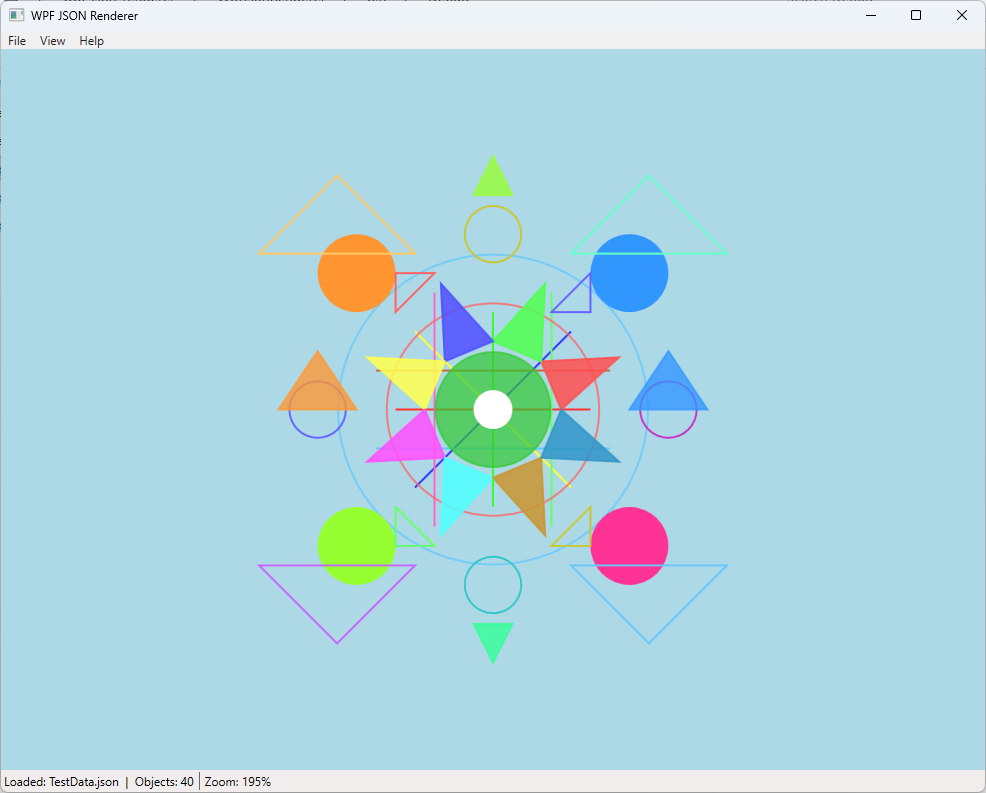

# Vector Scene Renderer

A simple 2D vector graphics viewer implemented in **C# / WPF (.NET Framework 4.8)**.

The application loads a scene description from a JSON file and renders basic geometric primitives such as lines, circles, and triangles.

---

## Screenshot



> Replace `screenshot.png` with your actual image file in the repository root.

---

## Features

- Load scene from JSON file
- Render:
  - Lines
  - Circles
  - Triangles (with optional fill)
- Automatic scaling to fit the viewport
- Aspect ratio preservation
- Clean separation between domain logic and rendering
- Extensible architecture

---

## How to Run

1. Open the solution in **Visual Studio 2022**
2. Build the project
3. Run the application
4. Use **File → Open** to load a JSON scene

---

## Architecture Overview

The project is structured into several layers:

### Domain
- Core data structures (Point, Color, Shapes, Scene)
- No dependency on UI framework

### Application
- Scene transformation (scaling, coordinate conversion)
- Viewport logic

### Infrastructure
- Scene loading (JSON parser)
- File handling

### Presentation
- WPF UI
- Rendering logic (drawing primitives)

---

## Rendering Details

The renderer performs:

- Conversion from Cartesian coordinates (Y-up) to screen coordinates (Y-down)
- Uniform scaling to fit the available window
- Centering of the scene
- Drawing using WPF primitives

---

## Extensibility

### Add new primitive

1. Add a new shape in the Domain layer  
2. Extend rendering logic in Presentation  
3. Update loader if needed  

---

### Add new file format

1. Implement a new scene loader  
2. Register it in the application  
3. UI will automatically support it  

---

## Example JSON

```json
{
  "shapes": [
    {
      "type": "line",
      "x1": 0,
      "y1": 0,
      "x2": 100,
      "y2": 100,
      "color": "#FF0000"
    },
    {
      "type": "circle",
      "cx": 50,
      "cy": 50,
      "radius": 25,
      "color": "#00FF00"
    }
  ]
}

## Support

If you found this project interesting or useful, you can support my work:

[](https://github.com/sponsors/makarov-mm)